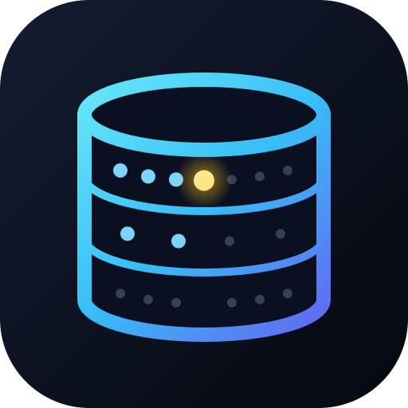

<p align="center">
  
</p>

# scheduler

[](https://github.com/Elojah/scheduler/actions/workflows/ci.yml)

Runs an operation at each time of a recurrence rule, for schedules kept in SQLite and managed over MQTT v5. It glues
[rrule](https://github.com/elojah/rrule), which expands RFC 5545 rules, and [alarm](https://github.com/elojah/alarm),
which fires a func at each of their times, one alarm per schedule. A web UI manages them too, and shows their times
on a calendar.

```sh
docker compose up -d mosquitto
go run ./cmd/scheduler config/scheduler/local.json
```

```sh
mosquitto_rr -V 5 -t scheduler/v1/schedules/create -e replies/me \
  -m '{"rule":"DTSTART:20260101T090000Z\nRRULE:FREQ=DAILY;BYDAY=MO,TU,WE,TH,FR","operation":"noop","enabled":true}'
```

## Schedule

```json
{
  "id": "01a163b0-fa59-7463-86e9-6a1c8baea7bb",
  "rule": "DTSTART;TZID=Europe/Paris:20260101T090000\nRRULE:FREQ=DAILY",
  "operation": "noop",
  "options": {"max_delay": "1s", "params": {"relay": 1}},
  "enabled": true
}
```

| Field | Holds |
| --- | --- |
| `id` | A UUIDv7, assigned by create: IDs sort by creation. |
| `rule` | A recurrence set, as RFC 5545 writes it: a `DTSTART` line, then `RRULE`, `RDATE`, `EXDATE` or `EXRULE` lines. Kept as sent. |
| `operation` | The key of a predefined operation. Only `noop` for now. |
| `options` | The alarm's tuning, and the operation's params. |
| `enabled` | Whether the operation runs. |

| Option | Does |
| --- | --- |
| `max_delay` | Drops a time passed by more than it, rather than running the operation late. |
| `coalesce` | Of a run of times passed by more than it, runs the operation only for the latest. |
| `spin` | Busy-waits the last of it before each time, to the microsecond rather than the millisecond, taking a core meanwhile. |
| `poll` | Bounds a wait, so that a clock step or a suspend shows within it: a minute by default. |
| `params` | Any JSON, handed to the operation as is. |

Durations are Go's, such as `"250ms"` or `"1m30s"`.

## MQTT API

The scheduler is a client of the broker. A request is a PUBLISH, with a JSON payload, to `<prefix>/schedules/<op>`,
the prefix being `mqtt.prefix` (`scheduler/v1` in `config/scheduler/local.json`). Its reply goes to the request's Response Topic, with its
Correlation Data: MQTT v5's request/response. A request without a Response Topic is served, but gets no reply.

| Topic | Payload | Reply |
| --- | --- | --- |
| `scheduler/v1/schedules/create` | `{rule, operation, options, enabled}` | `{"schedule": {…}}` |
| `scheduler/v1/schedules/get` | `{id}` | `{"schedule": {…}}` |
| `scheduler/v1/schedules/list` | `{}` | `{"schedules": […]}` |
| `scheduler/v1/schedules/update` | `{id, rule, operation, options, enabled}` | `{"schedule": {…}}` |
| `scheduler/v1/schedules/delete` | `{id}` | `{}` |

A refused request gets `{"error": {"code": …, "message": …}}`:

| Code | When |
| --- | --- |
| `invalid` | Malformed JSON, an unknown field or op, a rule rrule refuses, an unknown operation, a negative duration. |
| `not_found` | No schedule has the id. |
| `internal` | The database failed. |

## Web UI

`cmd/web_client` serves the web UI, built from `cmd/client` (Vue 3, PrimeVue, FullCalendar), and an HTTP API that
forwards to the scheduler over MQTT v5, as a client of the same broker. The UI lists the schedules, creates, edits,
enables and deletes them, and previews a rule's next times as it is typed. Its calendar shows the times of the enabled
schedules, by day, week or month.

```sh
docker compose up -d mosquitto
make run             # the scheduler
make client          # cmd/client/dist, with npm
make run-web_client  # http://localhost:8080
```

`npm run dev` in `cmd/client` serves the UI with hot reload on http://localhost:5173, proxying `/api` to the web
client.

| Route | Does |
| --- | --- |
| `POST /api/schedules/{op}` | Forwards the body to the scheduler's op, `create`, `get`, `list`, `update` or `delete`, and replies with its reply. |
| `GET /api/occurrences?from=…&to=…&merge=15m` | The times of each enabled schedule in a range of at most 62 days, RFC 3339 bounds: `{"occurrences": [{id, spans: [{start, end, count}], next, truncated}]}`. Times at most `merge` apart, 15m by default, are merged into a span. Past 10 000 times in the range, the last span lasts until its end, and `truncated` is set. |
| `POST /api/preview` | `{"rule": …}`: the rule's next 5 times, `{"times": […]}`, read as the scheduler reads it. |

Times are expanded by rrule, as the scheduler's alarms expand them. A past time shown ran only if its schedule was
enabled, and the scheduler up, then.

A refused request gets the scheduler's `{"error": {"code": …, "message": …}}`, with an HTTP status: `invalid` 400,
`not_found` 404, `internal` 500, and `unavailable` 503 or `timeout` 504 when the scheduler cannot be reached.

The web client has no auth, as the broker has none: whoever reaches it manages the schedules. It refuses the requests
of another site's pages (`http.CrossOriginProtection`).

## Behaviour worth knowing

- **Times start at now.** A schedule created, updated or loaded at startup runs from the next time of its rule:
  times passed while it was disabled, or the scheduler down, are not caught up.
- **Update does only what changed.** A new rule Resets the alarm, once the operation under way returns. A change of
  `max_delay`, `coalesce`, `spin` or `poll` replaces the alarm instead, since an alarm's tuning is fixed when it is
  created. A new operation or params applies from the next time, the alarm's times left as they were.
- **An operation runs in its schedule's alarm goroutine**: a slow one makes the next times of its schedule late, not
  those of others. `max_delay` and `coalesce` drop such late times.
- **Disable and delete never wait**: the operation under way finishes. On SIGHUP, SIGINT or SIGTERM, the requests
  under way are replied to, then operations under way get 5s in all before their ctx is cancelled.
- **Alarms ring whether the broker is up or not**: the scheduler reconnects on its own.
- **`DTSTART` is required**: a bare `FREQ=…` has no time to start from.

## Config

`scheduler [config.json]` reads the JSON file, if given and found, then the environment, which wins. A field set by
neither takes its default. Logs are JSON, on stdout.

| Key | Env | Default |
| --- | --- | --- |
| `log.level` | `LOG_LEVEL` | `info`; `debug` logs each time fired |
| `sqlite.path` | `SQLITE_PATH` | `scheduler.db` |
| `mqtt.broker` | `MQTT_BROKER` | `mqtt://localhost:1883`, or `tls://…` |
| `mqtt.client_id` | `MQTT_CLIENT_ID` | none: required |
| `mqtt.prefix` | `MQTT_PREFIX` | none: topics are then `schedules/<op>` |
| `mqtt.workers` | `MQTT_WORKERS` | `8`, requests served at once |
| `mqtt.queue` | `MQTT_QUEUE` | `64`, requests waiting for a worker before the next are dropped |
| `mqtt.reply_timeout` | `MQTT_REPLY_TIMEOUT` | `10`, in seconds, for the broker to acknowledge a reply |
| `mqtt.keep_alive` | `MQTT_KEEP_ALIVE` | `30`, in seconds, `0` to disable it |

The web client reads `web_client [config.json]` the same way, `config/web_client/local.json` for `make run-web_client`:

| Key | Env | Default |
| --- | --- | --- |
| `log.level` | `LOG_LEVEL` | `info` |
| `http.address` | `HTTP_ADDRESS` | `:8080` |
| `web.static` | `WEB_STATIC` | `/app/static`, the built client |
| `mqtt.broker` | `MQTT_BROKER` | `mqtt://localhost:1883` |
| `mqtt.client_id` | `MQTT_CLIENT_ID` | none: required, unique among the broker's clients. Replies come to `replies/<client_id>` |
| `mqtt.prefix` | `MQTT_PREFIX` | none: the scheduler's |
| `mqtt.timeout` | `MQTT_TIMEOUT` | `10`, in seconds, for the scheduler to reply |
| `mqtt.keep_alive` | `MQTT_KEEP_ALIVE` | `30`, in seconds, `0` to disable it |

## Layout

| Path | Holds |
| --- | --- |
| `cmd/scheduler` | The binary: config, wiring, and the MQTT API, one file per op. |
| `cmd/web_client` | The web UI's server: the built client, and the HTTP API, one file per endpoint. |
| `cmd/client` | The web UI: Vue 3, PrimeVue, FullCalendar, built by Vite. |
| `internal/schedule` | The domain: `Schedule`, the `Store` and `Service` interfaces, their errors and mocks. |
| `internal/schedule/service` | `service.S`, which rings an alarm per enabled schedule. |
| `internal/schedule/sqlite` | The `Store`, on SQLite. |
| `pkg/` | Libraries with no knowledge of schedules: `config`, `http`, `log`, `mqtt`, `shutdown`, `sqlite`. |
| `docker/` | The scheduler's and the web client's Dockerfiles, and the broker's conf, for `docker-compose.yml`. |

## Development

```sh
make check     # lint, and tests with -race
make build     # bin/scheduler, without cgo: GOOS=linux GOARCH=arm64 make build cross-compiles
make run       # with config/scheduler/local.json, on the broker at localhost:1883
make generate  # the moq mocks of internal/, after an interface changed

make client          # the web UI, into cmd/client/dist: npm ci, type-check, build
make web_client      # bin/web_client
make run-web_client  # with config/web_client/local.json, on localhost:8080
```

## Docker

```sh
docker compose up -d --build    # mosquitto on localhost:1883, the scheduler on it, and the web UI on localhost:8080
docker compose up -d mosquitto  # the broker alone, for make run
```

`docker/scheduler/Dockerfile` builds the binary into a `scratch` image, run as uid 65532, with
`config/scheduler/docker.json` mounted at `/app/docker.json`: the environment still wins over it. Schedules are kept in
the `data` volume, at `/data/scheduler.db`. The builder cross-compiles:
`docker buildx build --platform linux/arm64 -f docker/scheduler/Dockerfile .`.

`docker/web_client/Dockerfile` builds the client with node, then the binary, into a `scratch` image as well, with
`config/web_client/docker.json` mounted at `/app/docker.json`.

## License

MIT.
